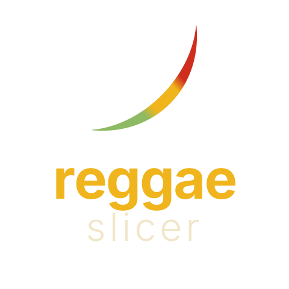

# Reggae Slicer 4.20

**Fork do [OrcaSlicer](https://github.com/OrcaSlicer/OrcaSlicer) feito para uma Anycubic Kobra X de 4 cores, com a paleta reggae e integrado ao [Selecta 3D](https://github.com/vicenzobz/selecta-3d).**

*A fork of OrcaSlicer for a 4-colour Anycubic Kobra X, with a reggae palette and a link to the Selecta 3D print organizer. Portuguese (Brazil) first.*

> [!IMPORTANT]
> **Projeto pessoal, compartilhado para testes e como referência para outros projetos.** Eu não dou suporte a quem for usar: issues e pedidos podem ficar sem resposta. Se quiser adaptar à sua impressora ou à sua rotina, use um agente de IA como o **[Claude Code](https://claude.com/claude-code)** ou o **[Codex](https://openai.com/codex)**: aponte o agente para este repositório e peça as mudanças que quiser. Foi assim que este fork foi feito.

## O que é

O Reggae Slicer é o OrcaSlicer 2.5.2 com mudanças pequenas e localizadas. O fatiamento, os perfis e os arquivos são os do OrcaSlicer: um 3MF salvo aqui abre no OrcaSlicer e no Anycubic Slicer Next, e vice-versa. O que muda é a cara do programa e a ligação com o Selecta 3D, o organizador de impressão 3D do mesmo autor.

| | |
|---|---|
| **Base** | OrcaSlicer 2.5.2 (versão interna; aparece no Sobre) |
| **Versão** | 4.20 (4.20.1.0.0 completa) |
| **Impressora** | Anycubic Kobra X (perfis oficiais que já vêm no OrcaSlicer) |
| **Sistema** | Windows x64 (só este é compilado) |
| **Licença** | AGPL-3.0, a mesma do OrcaSlicer (`LICENSE.txt`) |

## O que muda em relação ao OrcaSlicer

**Visual**
- Paleta do Selecta 3D: ouro `#F0B41C`, musgo `#4D7C2A`, vermelho `#CF2E1F`, fundos cor de madeira e texto cor de papel; cena 3D e mesa no mesmo tom.
- Modo escuro por padrão; **Exibir → Modo escuro** troca na hora, e **Exibir → Fundo claro** clareia só a cena 3D (para peças escuras).
- Logo do arco na abertura, nos ícones e na mesa da Kobra X; "4.20" na abertura (na próxima compilação, já no ramo `reggae-proximo`).
- Contraste conferido: o script `scripts/reggae/mostruario.py` roda antes de cada compilação e barra a compilação se algum par de cores ficar ilegível.

**Uso**
- **Página inicial com o Selecta 3D:** próximas peças da fila (botão Abrir carrega o arquivo), projetos ativos e o estoque de filamentos, lidos de um arquivo que o Selecta 3D grava.
- **Filamentos do estoque como perfis:** cada cor de PLA do estoque vira um filamento com cor, marca, temperatura e preço; escolher um deles leva a cor para o slot.
- **Sem conta e sem nuvem por padrão** (modo furtivo); login e nuvens escondidos na página inicial.
- Aba "Projeto" (informações do modelo do 3MF) retirada.
- Executável `reggae-slicer.exe` (na próxima compilação; até lá, `orca-slicer.exe`); a pasta de configurações `dados-orca` fica ao lado do programa, quando existe.

## Como baixar

Não há página de versões. Cada push no ramo `reggae` compila o Windows x64 no GitHub Actions (workflow **Reggae Slicer - Windows**, ~45–70 min):

1. Abra a aba **Actions**, escolha a última execução verde de **Reggae Slicer - Windows**.
2. Em **Artifacts**, baixe `ReggaeSlicer_4.20_Windows_x64_portable` (precisa estar logado no GitHub).
3. Extraia e abra `reggae-slicer.exe` (nas compilações até a 4.20, `orca-slicer.exe`). É portátil: não instala nada.

O Windows pode avisar que o programa não é assinado ("Mais informações → Executar assim mesmo").

## Ramos

| Ramo | Para quê |
|---|---|
| `reggae` | o que é compilado (padrão deste repositório) |
| `reggae-proximo` | mudanças guardadas para a próxima compilação (não compila sozinho) |
| `main` | cópia do OrcaSlicer, sem as mudanças do Reggae Slicer |

Para achar as mudanças no código, procure por `Reggae Slicer` nos comentários.

## Créditos

Tudo o que importa no fatiamento é do **[OrcaSlicer](https://github.com/OrcaSlicer/OrcaSlicer)** e de quem veio antes dele (Slic3r, PrusaSlicer, Bambu Studio, SuperSlicer). O README original do OrcaSlicer está em [`README_OrcaSlicer.md`](README_OrcaSlicer.md). Este fork não tem ligação com a Anycubic nem com a equipe do OrcaSlicer; "Kobra X" e "Anycubic" são marcas da Anycubic.
